# 🎮 PLAYER CARD: SHK CHAN 🎮

  

---

### 🕹️ VIBE GAMING & BLOG PORTAL
> 🌐 **Personal Website & Gaming Blog**: [https://shkchan.pages.dev](https://shkchan.pages.dev) *(Hosted on Cloudflare Pages)*

---

### 🏹 DEV ATTRIBUTES & CORE QUESTS

| Attribute | Level / Mastery | Focus Area & Technical Loadout |
| :--- | :--- | :--- |
| **DEX (Full-Stack Web)** | `██████████` 99 | **Node.js, Java (Spring Boot), Angular, TypeScript, RESTful APIs, Docker** |
| **STR (GUI & C++ App)** | `█████████░` 95 | **C++ (Qt Framework, Legacy MFC Refactoring), Multi-threading, Hardware Driver Integration** |
| **INT (Computer Vision)** | `█████████░` 93 | **OpenCV, Real-Time Industrial Inspection, Image Processing, Object Detection** |
| **WIS (Architecture)** | `██████████` 98 | **Clean Architecture, Deterministic Automated Workflows, CI/CD Pipelines** |

---

### 📊 GITHUB QUEST STATS

